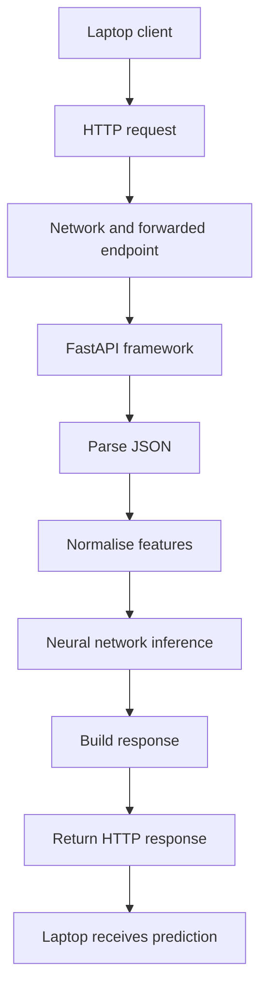

# Mission 3: Serve It and Time Every Stage

**Project:** EDGE AI – Team 13  
**Project Title:** How Long Will the Battery Last?  
**Model:** Battery Life Prediction Neural Network  
**Mission:** Mission 3 – Serve It and Time Every Stage

---

## 1. Introduction

The objective of Mission 3 is to deploy the battery-life prediction model through an API, validate incoming sensor readings, and measure the time required to process prediction requests.

The experiment focuses on understanding the difference between model inference time and total API response time. It also compares local execution with remote execution through GitHub Codespaces and evaluates the performance benefit of batch prediction.

The following activities were completed:

- Implemented sensor input validation.
- Added timing measurements for individual API processing stages.
- Benchmarked the API from the laptop and Codespace environments.
- Compared keep-alive and no-keepalive HTTP connections.
- Compared 400 individual prediction requests with one batch request containing 400 readings.
- Tested invalid sensor inputs through Swagger documentation.

## 2. Model and API Overview

The project uses a feed-forward neural network to predict the remaining battery life of a smart doorbell.

**Model architecture:**

`5 → 16 → 16 → 1`

| Property         |     Value |
| ---------------- | --------: |
| Input features   |         5 |
| Hidden layers    |         2 |
| Hidden units     |    16, 16 |
| Output           |         1 |
| Total parameters |       385 |
| Validation MAE   | 6.42 days |

The model accepts five sensor features:

1. Battery voltage (`battery_v`)
2. Temperature (`temp_c`)
3. Rings per day (`rings_per_day`)
4. Wi-Fi signal strength (`wifi_rssi_dbm`)
5. Battery age in months (`age_months`)

The FastAPI application provides the following endpoints:

| Endpoint         | Purpose                                           |
| ---------------- | ------------------------------------------------- |
| `/health`        | Checks API availability and model status          |
| `/model_info`    | Returns model architecture and memory information |
| `/predict`       | Predicts battery life for one sensor reading      |
| `/predict_batch` | Predicts battery life for multiple readings       |

## 3. Sensor Input Validation

Real sensor readings may occasionally contain glitches, impossible values, or communication errors. To prevent invalid readings from reaching the model, input validation ranges were implemented in `app/main.py`.

The ranges are based on plausible sensor operating limits rather than simply using the minimum and maximum values found in the training dataset.

### 3.1 Implemented input ranges

| Feature         | Minimum | Maximum | Unit   |
| --------------- | ------: | ------: | ------ |
| `battery_v`     |       0 |       5 | Volts  |
| `temp_c`        |     -40 |      85 | °C     |
| `rings_per_day` |       0 |    1000 | Rings  |
| `wifi_rssi_dbm` |    -100 |       0 | dBm    |
| `age_months`    |       0 |     240 | Months |

Values outside these ranges are rejected by the API with HTTP 422.

These are application-level validation limits. They should not be interpreted as a complete electrical or hardware safety specification.

### 3.2 Glitch testing

Three invalid sensor readings were submitted through the FastAPI Swagger interface at `/docs`.

| Test | Invalid input            | Validation limit   | Actual result |
| ---- | ------------------------ | ------------------ | ------------- |
| 1    | Battery voltage = 6 V    | Maximum 5 V        | HTTP 422      |
| 2    | Temperature = 100°C      | Maximum 85°C       | HTTP 422      |
| 3    | Battery age = 250 months | Maximum 240 months | HTTP 422      |

**Result:** All three invalid input tests successfully returned HTTP 422 Unprocessable Entity.

This confirms that the API rejects these tested out-of-range readings rather than passing them to the prediction model.

## 4. Benchmark Methodology

The benchmark script `client/bench.py` was used to measure API response times.

The script sends individual readings to `/predict` and records:

- First request round-trip time.
- Median response time (p50).
- 95th percentile response time (p95).
- 99th percentile response time (p99).
- Individual server processing stages.
- Network and framework overhead.

The server reports the following timing stages:

| Stage                 | Description                                   |
| --------------------- | --------------------------------------------- |
| Parse                 | Reading and parsing the incoming JSON request |
| Normalise             | Normalising the input features                |
| Inference             | Running the neural network prediction         |
| Build                 | Preparing the API response                    |
| Server total          | Total reported server processing time         |
| Network and framework | Round trip minus reported server total        |

The benchmark records the first request separately. The p50, p95 and p99 values are calculated using subsequent requests, excluding the first request.

The residual `network_and_framework` is calculated as:

`network_and_framework = round_trip - server_total`

It includes time outside the measured server stages. It should not be interpreted as pure network transmission time because it can also include HTTP client, server framework, connection and scheduling overhead.

## 5. Benchmark Results

Four benchmark environments were tested.

### 5.1 Laptop localhost — Keep-alive enabled

**Evidence file:** `bench_20261123_165826.csv`

The benchmark was executed from the Windows laptop against the local API.

**First request:** 2065.8 ms

| Stage                 | p50 (ms) | p95 (ms) | p99 (ms) |
| --------------------- | -------: | -------: | -------: |
| Round trip            |    1.978 |    3.402 |   11.368 |
| Parse                 |    0.001 |    0.002 |    0.003 |
| Normalise             |    0.026 |    0.048 |    0.064 |
| Inference             |    0.183 |    0.312 |    0.379 |
| Build                 |    0.015 |    0.029 |    0.048 |
| Server total          |    0.237 |    0.389 |    0.527 |
| Network and framework |    1.738 |    3.001 |   10.927 |

Percentiles were calculated from requests 2–200.

**Observation:** After the first request, the median round-trip time was approximately 1.98 ms. The model inference stage took approximately 0.183 ms at p50.

### 5.2 Laptop localhost — No-keepalive

**Evidence file:** `bench_20261123_171825.csv`

The benchmark was repeated with `--no-keepalive`, causing a new HTTP connection to be used for each request.

**First request:** 2055.486 ms

**Successful requests:** 200  
**Failed requests:** 0

| Stage                 | p50 (ms) | p95 (ms) | p99 (ms) |
| --------------------- | -------: | -------: | -------: |
| Round trip            | 2049.505 | 2071.757 | 2083.571 |
| Parse                 |    0.002 |    0.006 |    0.007 |
| Normalise             |    0.054 |    0.133 |    0.162 |
| Inference             |    0.373 |    0.838 |    1.316 |
| Build                 |    0.031 |    0.073 |    0.088 |
| Server total          |    0.485 |    1.091 |    1.448 |
| Network and framework | 2049.051 | 2070.776 | 2082.545 |

Percentiles were calculated from requests 2–200.

**Observation:** The no-keepalive experiment produced an unusually high median round-trip time of approximately 2.05 seconds, compared with approximately 1.98 ms in the keep-alive experiment.

The exact underlying cause of this environment-specific delay was not isolated in this experiment. However, the measurements demonstrate that connection reuse made a substantial difference in this particular test environment.

The result should not be interpreted as a universal cost of creating a new HTTP connection.

### 5.3 Laptop to GitHub Codespace

**Evidence file:** `bench_20261123_172725.csv`

The benchmark was executed from the Windows laptop against the API exposed through the GitHub Codespace forwarded port.

**First request:** 1069.179 ms

**Successful requests:** 200  
**Failed requests:** 0

| Stage                 | p50 (ms) | p95 (ms) | p99 (ms) |
| --------------------- | -------: | -------: | -------: |
| Round trip            |   34.024 |   58.944 |  206.655 |
| Parse                 |    0.001 |    0.001 |    0.003 |
| Normalise             |    0.021 |    0.033 |    0.065 |
| Inference             |    0.113 |    0.180 |    0.375 |
| Build                 |    0.014 |    0.019 |    0.041 |
| Server total          |    0.159 |    0.244 |    0.505 |
| Network and framework |   33.863 |   58.786 |  206.233 |

Percentiles were calculated from requests 2–200.

**Observation:** The median laptop-to-Codespace round trip was 34.024 ms, while the server processing time was only 0.159 ms.

This indicates that most of the measured response time occurred outside the reported server processing stages.

### 5.4 Codespace localhost

**Evidence file:** `bench_20261123_115841.csv`

The benchmark was executed from inside the Codespace against `http://localhost:8000`.

**First request:** 2.8 ms

| Stage                 | p50 (ms) | p95 (ms) | p99 (ms) |
| --------------------- | -------: | -------: | -------: |
| Round trip            |    1.989 |    2.677 |    4.100 |
| Parse                 |    0.001 |    0.001 |    0.001 |
| Normalise             |    0.021 |    0.041 |    0.050 |
| Inference             |    0.124 |    0.165 |    0.242 |
| Build                 |    0.015 |    0.017 |    0.041 |
| Server total          |    0.174 |    0.217 |    0.307 |
| Network and framework |    1.811 |    2.476 |    3.933 |

Percentiles were calculated from requests 2–200.

**Observation:** The median round-trip time inside the Codespace was approximately 1.99 ms. This was much lower than the 34.024 ms median measured from the laptop through the forwarded public endpoint.

## 6. Comparison of Benchmark Environments

The following table compares the median results.

| Measurement           | Laptop localhost, keep-alive | Laptop localhost, no-keepalive | Laptop to Codespace | Codespace localhost |
| --------------------- | ---------------------------: | -----------------------------: | ------------------: | ------------------: |
| Round trip p50 (ms)   |                        1.978 |                       2049.505 |              34.024 |               1.989 |
| Round trip p95 (ms)   |                        3.402 |                       2071.757 |              58.944 |               2.677 |
| Round trip p99 (ms)   |                       11.368 |                       2083.571 |             206.655 |               4.100 |
| Inference p50 (ms)    |                        0.183 |                          0.373 |               0.113 |               0.124 |
| Server total p50 (ms) |                        0.237 |                          0.485 |               0.159 |               0.174 |

### Key findings

1. Laptop localhost with keep-alive achieved a median round-trip time of 1.978 ms.
2. Laptop localhost without keep-alive showed a much higher median of 2049.505 ms in this particular environment.
3. Laptop-to-Codespace requests had a median round-trip time of 34.024 ms.
4. Codespace-local requests had a median round-trip time of 1.989 ms.
5. The inference stage remained very small in all four experiments.

The laptop-to-Codespace result includes the additional communication path through the forwarded Codespace endpoint. It should not be directly treated as a measurement of network transmission alone.

## 7. Where Does the Time Go?

The laptop-to-Codespace experiment is useful for understanding the distribution of request time.

The median measurements were:

| Component             |  p50 time |
| --------------------- | --------: |
| Parse                 |  0.001 ms |
| Normalise             |  0.021 ms |
| Inference             |  0.113 ms |
| Build                 |  0.014 ms |
| Server total          |  0.159 ms |
| Network and framework | 33.863 ms |
| Total round trip      | 34.024 ms |

The percentage outside the reported server stages is approximately:

`(33.863 / 34.024) × 100 ≈ 99.53%`

Therefore, approximately 99.5% of the median round-trip time was outside the measured server processing stages.

### 7.1 Request flow diagram

### 7.2 Timing interpretation

The neural network inference stage takes only a small fraction of the total request time.

For the laptop-to-Codespace experiment:

- Inference p50: 0.113 ms.
- Server total p50: 0.159 ms.
- Round-trip p50: 34.024 ms.

This shows that optimising neural-network inference alone would have limited impact on the overall laptop-to-Codespace response time.

Connection handling, network communication and framework overhead are more significant contributors to the measured end-to-end latency in this experiment.

## 8. Effect of Keep-Alive

HTTP keep-alive allows a client to reuse an existing connection for multiple requests.

In the laptop localhost experiment:

- Keep-alive median round trip: 1.978 ms.
- No-keepalive median round trip: 2049.505 ms.

The measured difference is substantial.

The experiment demonstrates the importance of testing connection behaviour when evaluating API latency. The exact cause of the unusually high no-keepalive delay was not isolated, so it should be treated as an observation specific to this environment rather than a general HTTP performance rule.

## 9. Effect of Remote Execution

The Codespace-local benchmark measured a median round-trip time of 1.989 ms.

The laptop-to-Codespace benchmark measured 34.024 ms.

This difference demonstrates that the location of the client and API affects the end-to-end response time.

Even though the server processing time remained below 1 ms at p99 in the laptop-to-Codespace experiment, the remote request still required additional time to travel through the network and forwarded endpoint.

This distinction is important when deploying machine-learning APIs for real-time applications.

## 10. Batch Prediction Experiment: 400 Individual Requests vs One Batch

The batch experiment was performed using `benchmark_400.py`.

The same 400 sensor readings were used for both approaches.

### 10.1 Experiment design

**Individual prediction approach:**

- Send 400 separate HTTP requests to `/predict`.
- Receive one prediction for each request.
- Measure the total elapsed time.

**Batch prediction approach:**

- Send one HTTP request to `/predict_batch`.
- Include all 400 readings in the request payload.
- Receive 400 predictions.
- Measure the total elapsed time.

### 10.2 Actual results

| Measurement              | Individual requests | Batch request |
| ------------------------ | ------------------: | ------------: |
| Number of HTTP requests  |                 400 |             1 |
| Number of predictions    |                 400 |           400 |
| Total elapsed time       |        44,772.82 ms |    937.444 ms |
| Approximate elapsed time |       44.77 seconds |  0.94 seconds |

**Calculated batch speedup:**

`Speedup = Individual time / Batch time`

`Speedup = 44772.82 / 937.444`

`Speedup ≈ 47.76×`

The batch approach was approximately 47.76 times faster in this experiment.

### 10.3 Prediction consistency

The maximum absolute difference between corresponding individual and batch predictions was:

`0.01 days`

The experiment used a tolerance of 0.01 days.

**Result:** All 400 batch predictions matched the individual predictions within the experiment's accepted tolerance.

### 10.4 Explanation

The individual approach sends 400 separate HTTP requests. Each request requires its own request handling and response processing.

The batch approach sends all 400 readings in one HTTP request. This reduces repeated HTTP request overhead and allows the model to process multiple readings together.

The experiment demonstrates that batch prediction can significantly improve throughput when multiple sensor readings are available at the same time.

The measured 47.76× speedup applies to this particular experiment and environment; it should not be assumed to be identical in every deployment.

## 11. Benchmark Evidence

The following files contain the benchmark evidence used in this report:

| File                        | Description                                                         |
| --------------------------- | ------------------------------------------------------------------- |
| `bench_20261123_165826.csv` | Laptop localhost with keep-alive                                    |
| `bench_20261123_171825.csv` | Laptop localhost without keep-alive                                 |
| `bench_20261123_172725.csv` | Laptop-to-Codespace benchmark                                       |
| `bench_20261123_115841.csv` | Codespace-local benchmark                                           |
| `benchmark_400.py`          | Script for comparing 400 individual requests with one batch request |
| `test_batch.py`             | Existing 50-reading batch consistency test                          |
| `app/main.py`               | API implementation and input validation                             |
| `client/bench.py`           | API timing benchmark implementation                                 |

The four CSV files were generated by the benchmark script. The 400-versus-batch experiment results were recorded from the execution output of `benchmark_400.py`.

The original benchmark CSVs should be retained alongside the report as supporting evidence.

## 12. LLM Latency Prediction Comparison

The original numerical latency prediction made by the LLM could not be located in the available project evidence used to prepare this report.

Therefore, a numerical comparison between the LLM prediction and measured latency cannot be established reliably.

The measured benchmark results are presented independently, without claiming that the original prediction was correct or incorrect.

A future comparison can be added if the original LLM estimate becomes available.

## 13. Key Findings

The Mission 3 experiments produced the following findings:

1. The API successfully serves battery-life predictions through FastAPI.
2. The API rejects the three tested invalid sensor readings with HTTP 422.
3. The model inference stage takes a very small amount of time compared with the full remote request round trip.
4. Laptop-to-Codespace requests have higher end-to-end latency than Codespace-local requests.
5. The keep-alive experiment showed substantially lower latency than the no-keepalive experiment in the tested Windows environment.
6. Batch prediction was approximately 47.76 times faster than sending 400 individual requests in the measured experiment.
7. Individual and batch predictions matched within the accepted tolerance of 0.01 days.

## 14. Conclusion

Mission 3 successfully demonstrated that the battery-life prediction model can be served through a FastAPI application and that the API can validate incoming sensor data before performing inference.

The benchmarking experiments showed that model inference is not the main contributor to end-to-end latency in the laptop-to-Codespace deployment. Most of the measured time occurred outside the reported server processing stages.

The batch prediction experiment also demonstrated a significant performance benefit. Processing 400 readings in one batch request took approximately 0.94 seconds, compared with approximately 44.77 seconds for 400 individual requests.

Overall, the results show the importance of considering API communication overhead, connection handling and batch processing when deploying machine-learning models in real applications.

Mission 3 requirements for input validation, stage timing, benchmark comparisons and batch performance testing were addressed through the experiments documented in this report.
